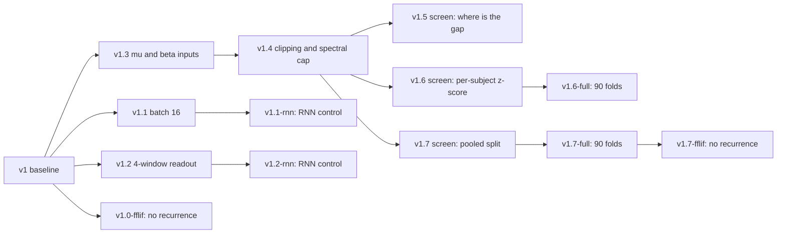

# Experiments v1 to v1.7 and the control runs

> Code, settings and results of every version of the local training runs: 7 full runs (v1 to v1.4, v1.6-full and v1.7-full, scored on the test set), 3 screens (v1.5 to v1.7, session 1 only) and 4 control runs (v1.1-rnn and v1.2-rnn: the RNN with the v1.1 and v1.2 changes; v1.0-fflif and v1.7-fflif: the RSNN without its recurrence). Each folder has its own README.

## 1. Versions at a glance



```
v1 --+-- v1.1  (batch 16) ------------ v1.1-rnn  (RNN control, batch 16)
     +-- v1.2  (4-window readout) ---- v1.2-rnn  (RNN control, 4-window readout)
     +-- v1.0-fflif  (RSNN without recurrence)
     +-- v1.3  (mu + beta inputs) -- v1.4 (clipping + spectral cap) --+-- v1.5 screen
                                                                     +-- v1.6 screen -- v1.6-full (90 folds)
                                                                     +-- v1.7 screen -- v1.7-full (90 folds) -- v1.7-fflif
```

| Folder | Kind | One change (from) | Models trained | Scored on | RSNN accuracy | EEGNet accuracy |
|---|---|---|---|---|---:|---:|
| `v1/` | Full run, 90 folds | Baseline, as planned | EEGNet, SNN, RSNN, RNN | Session 2 | 0.364 | 0.597 |
| `v1.1/` | Full run, 90 folds | RSNN batch 64 → 16 (v1) | RSNN | Session 2 | 0.386 | 0.597 (v1) |
| `v1.2/` | Full run, 90 folds | 4-window readout, 14 neurons (v1) | RSNN | Session 2 | 0.371 | 0.597 (v1) |
| `v1.3/` | Full run, 90 folds | Mu and beta band inputs, 12 neurons (v1) | RSNN, RNN | Session 2 | 0.428 | 0.597 (v1) |
| `v1.4/` | Full run, 90 folds | Gradient clipping 1.0, initial spectral norm ≤ 0.9 (v1.3) | RSNN, RNN | Session 2 | 0.432 | 0.597 (v1) |
| `v1.5/` | Screen | None: diagnostic of v1/v1.4 weights, fine-tuning only arm | EEGNet, RSNN, RNN | Session 1 | 0.485 (fine-tuned, 20 % split) | 0.631 |
| `v1.6/` | Screen, 9 folds | Per-subject z-score (v1.4) | EEGNet, RSNN, RNN | Session 1 | 0.490 (20 % split) | 0.648 |
| `v1.7/` | Screen, 9 folds | Pooled 80 / 20 pretraining split (v1.4) | EEGNet, RSNN, RNN | Session 1 | 0.529 (20 % split) | 0.686 |
| `v1.6-full/` | Full run, 90 folds | Per-subject z-score (v1.4) | EEGNet, SNN, RNN | Session 2 | not run | 0.609 |
| `v1.7-full/` | Full run, 90 folds | Pooled 80 / 20 pretraining split (v1.4) | EEGNet, SNN, RSNN, RNN | Session 2 | 0.470 | 0.654 |
| `v1.1-rnn/` | Control run, 90 folds | RNN batch 64 → 16, as the v1.1 RSNN (v1.1) | RNN | Session 2 | RNN 0.437 | 0.597 (v1) |
| `v1.2-rnn/` | Control run, 90 folds | RNN with the 4-window readout, 14 units, as the v1.2 RSNN (v1.2) | RNN | Session 2 | RNN 0.422 | 0.597 (v1) |
| `v1.0-fflif/` | Control run, 90 folds | RSNN without recurrent weights, 28 neurons, 760 parameters (v1) | FF-LIF | Session 2 | FF-LIF 0.380 | 0.597 (v1) |
| `v1.7-fflif/` | Control run, 90 folds | RSNN without recurrent weights, 15 neurons, 739 parameters (v1.7-full) | FF-LIF | Session 2 | FF-LIF 0.479 | 0.654 (v1.7-full) |

Session-2 accuracies are means over 9 subjects (each the mean of 10 repeats). Converted SNN: v1 0.569, v1.6-full 0.578, v1.7-full 0.647. RNN control: v1 0.411, v1.6-full 0.423, v1.7-full 0.477. In the control rows the accuracy column gives the control model, not the RSNN. Screen accuracies are on session-1 data and are **not comparable** with the session-2 column of the full runs.

> ⚠️ All numbers here are **preliminary**. They were made before the pipeline validation checklist passed, and the RSNN's test set was scored in 5 versions. The screens did not meet their decision rules, so no screen setting was carried into a full run. v1.6-full and v1.7-full were run later to measure the two screen changes on the test set for the comparison tables; they are exploratory too.

## 2. Folder layout

| Path | What it holds |
|---|---|
| `v1/` … `v1.4/` | `README.md`, `code/` (pipeline source as run, local launch helpers), `results/<run id>/` (the complete run folder: config, folds, predictions, metrics, histories, checkpoints, statistics, figures, logs) |
| `v1.6-full/`, `v1.7-full/`, `v1.1-rnn/`, `v1.2-rnn/`, `v1.0-fflif/`, `v1.7-fflif/` | The same layout as `v1/`: `README.md`, `code/` (pipeline source as run, launch helpers), `results/<run id>/` (complete run folder). The control runs hold only the model they trained |
| `v1.1/` … `v1.4/`, and every folder above: `CODE_CHANGES_vs_<base>.diff` | Every source line that differs from the version it was built from |
| `v1.5/` … `v1.7/` | `README.md`, `code/` (screen scripts, the same in all three), `results/` (one JSON per job, logs, `summary.json`) |
| `summary/` | `compute_metrics.py` and its output `metrics_by_version.csv`: accuracy, Cohen's kappa, macro-F1, macro specificity, macro precision and subjects above chance for every model that a full or control run trained (the rows labelled `v1.6` and `v1.7` are the `-full` runs) |
| `summary/build_tables.py`, `table31.csv`, `table32.csv`, `table33.csv` | Table 31: every version × model, session 2 and session 1. Table 32: all metrics per model and run (the same values as `metrics_by_version.csv`). Table 33: RSNN against FF-LIF for v1 and v1.7, with an exact Wilcoxon test |
| `summary/score_saved.py`, `summary/session1_scores/` | Session-1 scores (target's 20 % fine-tuning validation split, 9 development folds) of the saved fine-tuned checkpoints of every full and control run; no training, session 2 never reaches a model |

## 3. Use the results for analysis

| Task | Where |
|---|---|
| Recompute any test metric | `v*/results/<run id>/predictions/<model>/s<S>_r<R>.npz` (arrays `y_true` and `y_pred` of the 288 test trials, `scores` 288 × 4) or `predictions.csv` |
| Per-fold accuracy, kappa, macro-F1 | `results.csv` of the run |
| Confusion matrices | `confusion_matrices.csv` of the run |
| The pipeline statistics (chance, Wilcoxon with Holm correction, bootstrap) | `comparison/` of the run |
| Training curves | `histories/` of the run |
| All versions in one table | `summary/metrics_by_version.csv` (rerun: `python experiments/summary/compute_metrics.py` from the repository root) |
| Version × model table, both sessions; RSNN against FF-LIF | `summary/table31.csv`, `summary/table33.csv` (rerun: `python experiments/summary/build_tables.py`) |
| Session-1 score of a run's saved checkpoints | `summary/session1_scores/<run>.json` (rerun: `python experiments/summary/score_saved.py <run>`; downloads the dataset to `rssns_for_mi_EEG/data/` on first use) |

In v1.1 to v1.4, the models that did not change (see each README) were copied from v1, so these run folders hold all four models on the same 90 folds. The control runs (`-rnn`, `-fflif`) and `v1.6-full` hold only the models they trained; `summary/build_tables.py` pairs them with the other runs by subject. All runs use the same 90 folds and seeds.

## 4. Environment

`requirements.txt` pins the exact package versions of every run (Python 3.12, torch 2.4.0).

```bash
# from the repository root
uv venv --python 3.12 .venv
uv pip install -r experiments/requirements.txt
```

`uv sync` is not used here: it needs a `pyproject.toml` and a `uv.lock`, and the repository has neither

#

## Glossary

| Term | Meaning |
|---|---|
| ANN | Artificial neural network, here EEGNet |
| SNN | Spiking neural network, here EEGNet converted to spiking neurons |
| RSNN | Recurrent spiking neural network: one all-to-all recurrent layer of leaky integrate-and-fire neurons |
| RNN control | Recurrent neural network with the ELU (exponential linear unit) activation, the same size and training as the RSNN, without spikes |
| FF-LIF control | Feedforward leaky integrate-and-fire: the RSNN without its recurrent weight matrix, widened to the same parameter budget. Each neuron keeps its own leaky memory but gets no spikes from other neurons |
| Full run | 90 folds, every fold scored on session 2 |
| Control run | A full run of one control model (RNN or FF-LIF) that differs from the RSNN of the same version in one property |
| EEG | Electroencephalography |
| Session 1 / session 2 | The two recording days of BCI IV 2a (Brain-Computer Interface Competition IV, dataset 2a). Session 2 is the test set |
| Fold | One target subject and one random draw of 5 pretraining and 3 validation subjects. 9 targets × 10 repeats = 90 folds |
| Development folds | Repeat 0 of each target: 9 folds used by the screens |
| Screen | A short experiment on session-1 data that ranks a setting without using the test set |
| Spectral norm | The largest singular value of a matrix. Above 1 a recurrent layer can amplify its own activity |
| Gradient clipping | Scaling the gradient down when its norm is above a limit, so one update cannot be very large |
| Z-score | (value − mean) / standard deviation |
| Macro-F1 | The F1 score (harmonic mean of precision and recall) averaged over the 4 classes |
| GPU | Graphics processing unit |
