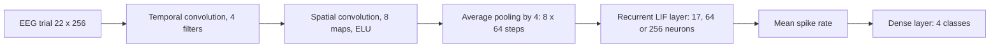

# v2.x: screens that test the feedback on the project summary (session 1 only)

> A department professor read the project summary and raised four points. Each v2.x version tests one of them. Every result here is a screen: 9 development folds, scored on 58 validation trials of each target subject's session 1. Session 2 was never loaded. `V2x_Meeting_Page.html` shows the same results with figures and loss curves.

## 0. Status

| Item | State | Your open action |
|---|---|---|
| All arms | Done, 9 folds each | None |
| Audit | No leakage found. Results are noisy and optimistic (section 5) | Read section 5 before using a number |
| Scored run on session 2 | Not done | `[TBD: which version gets a scored session-2 run]` |
| Plan status | `[DEVIATION: every v2.x model departs from the plan's one-layer, parameter-matched RSNN]` | Report as exploratory |

## 1. Feedback points and versions

| # | Point in the feedback | Version | Test |
|---|---|---|---|
| 1 | 17 recurrent neurons are too few, and parameter matching is not a fair rule | v2.1 | The RSNN on raw EEG with 256 and 1,024 neurons |
| 2 | Add a feature-extraction stage like EEGNet's convolutions | v2.2, v2.2b | EEGNet block 1 in front of the recurrent layer, trained with it (v2.2) or copied from the trained EEGNet and frozen (v2.2b) |
| 3 | Try reservoir computing with 500 to 2,000 neurons | v2.3 | Fixed random LIF reservoir with a trained dense layer |
| 4 | How are the 22 channels presented? 256 steps are long | v2.2 | The front end gives 8 values per step over 64 steps |
| | What does EEGNet's first layer extract? | v2.0 | Filter analysis in `filters/` (no training) |
| | Training schedule | v2.2c, v2.2d | Learning-rate schedule; 1,000 fine-tuning epochs. EEGNet gets the same change |



```
EEG trial 22 x 256 -> temporal conv (4 filters) -> spatial conv (8 maps, ELU) -> average pooling by 4 (8 x 64 steps)
                   -> recurrent LIF layer (17, 64 or 256 neurons) -> mean spike rate -> dense layer (4 classes)
```

EEGNet layers used before the recurrent layer: `conv1`, `bn1`, `depthwise`, `bn2`, ELU, `pool1`, `drop1`. Not used: the separable convolution (`sep_depth`, `sep_point`, `bn3`, `pool2`, `drop2`) and EEGNet's dense layer `fc`.

## 2. Results (accuracy on the target's 20 % split, mean of 9 folds)

| Version | Arm | Model | Trainable parameters | Before fine-tuning (288 trials) | After fine-tuning | Gap to `base17` |
|---|---|---|---|---|---|---|
| reference | `base17` | The main pipeline's RSNN architecture: 17 LIF neurons on raw EEG, 256 steps, trained with this screen's settings | 752 | 0.285 | 0.420 |  |
| v2.1 | `wide256` | The same with 256 neurons | 72452 | 0.284 | 0.423 | +0.004 (4 better, 4 worse) |
| v2.1 | `wide1024` | The same with 1,024 neurons | 1076228 | 0.288 | 0.400 | -0.019 (3 better, 5 worse) |
| v2.2 | `conv_rsnn17` | Front end + 17 recurrent LIF neurons | 842 | 0.357 | 0.527 | +0.107 (8 better, 0 worse) |
| v2.2 | `conv_rnn17` | Front end + 17 recurrent ELU units (non-spiking twin) | 842 | 0.326 | 0.490 | +0.071 (6 better, 2 worse) |
| v2.2 | `conv_rsnn64` | Front end + 64 recurrent LIF neurons (mean of 2 runs) | 5260 | 0.341 | 0.534 | +0.114 (9 better, 0 worse) |
| v2.2 | `conv_rnn64` | Front end + 64 recurrent ELU units (mean of 2 runs, unstable training) | 5260 | 0.343 | 0.449 | +0.030 (6 better, 2 worse) |
| v2.2 | `conv_fflif64` | Front end + 64 LIF neurons, recurrent weights fixed at zero | 1164 | 0.370 | 0.559 | +0.140 (9 better, 0 worse) |
| v2.2 | `conv_rsnn256` | Front end + 256 recurrent LIF neurons | 69196 | 0.322 | 0.550 | +0.130 (8 better, 1 worse) |
| v2.2b | `frozen_rsnn64` | Frozen EEGNet block 1 + 64 recurrent LIF neurons | 4932 | 0.332 | 0.630 | +0.211 (9 better, 0 worse) |
| v2.2b | `frozen_rnn64` | Frozen EEGNet block 1 + 64 recurrent ELU units | 4932 | 0.367 | 0.649 | +0.230 (9 better, 0 worse) |
| v2.2c | `sched_rsnn64` | Front end + 64 LIF neurons, warm-up and cosine learning-rate schedule | 5260 | 0.343 | 0.498 | +0.079 (6 better, 1 worse) |
| | EEGNet | Same folds and split (v1.5 screen) | 796 | 0.353 | 0.623 | |

| v2.2d: fine-tuning epochs allowed | Front end + 64 LIF neurons | EEGNet |
|---|---|---|
| 100 | 0.513 | 0.621 |
| 300 | 0.651 | 0.674 |
| 1,000 | 0.697 | 0.701 |

| v2.2b: frozen stage + 64 LIF neurons against the EEGNet it comes from, repeat | Frozen stage + RSNN | EEGNet | Gap | Subjects |
|---|---|---|---|---|
| 0 | 0.630 | 0.619 | +0.011 | 6 better, 2 worse |
| 1 | 0.676 | 0.693 | -0.017 | 3 better, 5 worse |
| 2 | 0.598 | 0.607 | -0.010 | 5 better, 3 worse |

| v2.3: reservoir neurons | Raw EEG, no recurrence | Raw EEG, recurrent (spectral radius 1.0) | Band input, no recurrence | Band input, recurrent |
|---|---|---|---|---|
| 500 | 0.483 | 0.456 | 0.515 | 0.479 |
| 1,000 | 0.487 | 0.446 | 0.559 | 0.502 |
| 2,000 | 0.511 | 0.492 | 0.565 | 0.533 |

## 3. What the screens show

| Finding | Evidence | Strength |
|---|---|---|
| The feature-extraction stage is the effective change | 17 neurons: 0.420 without, 0.527 with the front end (+0.107 (8 better, 0 worse)) | Far outside the noise |
| More neurons on raw EEG do not help | 0.420, 0.423, 0.400 for 17, 256, 1,024 neurons | Consistent |
| With the frozen EEGNet stage the recurrent spiking layer is level with EEGNet | Three repeats, gaps within 0.02 | Repeatable, but selected twice on the scoring split |
| Recurrence adds nothing | Front end + 64 LIF: 0.534 with, 0.559 without recurrence. Reservoir: lower with recurrence at every size | Consistent across versions |
| The front-end RSNN is undertrained at 100 fine-tuning epochs | Cut-off table above: the gap to EEGNet closes at 1,000 epochs | Both values are optimistic |

## 4. Settings

| Setting | Value |
|---|---|
| Folds | Repeat 0 of each of the 9 target subjects (v2.2b also repeats 1 and 2 for `frozen_rsnn64`) |
| Split | 5 pretraining and 3 validation subjects, target's session 1 split 80 / 20, as in the main pipeline (`v1.4` variant of `../v1.5/code/screen_common.py`) |
| Training | 500 + 100 epochs, Adam 0.001, dropout 0.25 and 0.5, gradient clipping 1.0 for recurrent models, lowest validation loss kept |
| Batch size | 64 for recurrent models, 16 for EEGNet |
| LIF neuron | Leak 0.9, threshold 1, reset by subtraction |
| Model code | The v1.4 pipeline code (`../v1.4/code/src`), unchanged |

## 5. Audit and limits

| Check | Result | Detail |
|---|---|---|
| Session 2 never used, split integrity, fitted statistics | ✅ Pass | Independent code review of all scripts, all 90 folds checked |
| Frozen EEGNet stage from the same folds | ✅ Pass | 0 of the 58 validation trials were in EEGNet's fine-tuning data |
| State reset between trials | ✅ Pass | `audit/reset_s3.json` |
| Label-shuffle test | ✅ 5 of 6 at or below the threshold 0.362 | Values: 0.28, 0.33, 0.28, 0.28, 0.22, 0.38 |
| Repeatability | ❌ Fail for arms that train the front end | 29 folds run twice: 14 changed, by up to 8 of 58 trials. A 9-fold mean moves by about 0.04. The frozen-stage arm repeats exactly |
| Selection on the scoring split | ❌ Limit | The 20 % split picks the kept epoch and gives the score |
| Like-for-like training | ⚠️ Limit | EEGNet gets 15 weight updates per fine-tuning epoch, the recurrent models 4 |

A difference of about 0.04 or less between two arms is not a finding. Only a run scored once on session 2 can confirm a result.

## 6. Files

| Path | Content |
|---|---|
| `code/screen_v2x.py` | v2.1 and v2.2 arms: one arm on one fold |
| `code/screen_v2x_frozen.py` | v2.2b. Needs the EEGNet checkpoints of the v1 run in `../v1/results/checkpoints/ann/` (not in the repository) |
| `code/screen_v2x_sched.py` | v2.2c and v2.2d, with the EEGNet counterparts |
| `code/screen_reservoir_v2x.py`, `code/reservoir.py` | v2.3 |
| `code/run_v2x.sh`, `code/jobs.txt` | Runs every job, 3 at a time, and skips finished ones |
| `code/analyze_v2x.py` | Writes the CSV files in `results/` |
| `code/audit_v2x.py`, `code/audit_summary.py` | Audit runs and their summary |
| `results/<arm>_s<T>_r<R>.json` | One file per arm and fold. `results/first_pass/`: the first run of folds that were run twice |
| `results/histories/` | Training and validation loss per epoch of every job |
| `results/*.csv` | `summary`, `comparisons`, `finetune_cutoffs`, `per_subject_ft_val`, `repeatability` |
| `results_reservoir/` | One file per reservoir arm and fold |
| `audit/` | Label-shuffle, state-reset, firing and EEGNet reference results |
| `filters/` | v2.0: frequency responses and channel weights of the trained EEGNet filters |

Rerun, from the repository root, with the environment of `../requirements.txt` and a GPU: build the data cache once with `python experiments/v1.5/code/screen_common.py`, then `PY=python experiments/v2.x/code/run_v2x.sh`.

## Glossary

| Short form | Full form |
|---|---|
| 20 % split | The 58 trials of the target's session 1 that are not used for fine-tuning |
| ELU | Exponential linear unit |
| LIF | Leaky integrate-and-fire neuron |
| RNN | Recurrent neural network with non-spiking units |
| RSNN | Recurrent spiking neural network |
| Reservoir | Recurrent network with fixed random weights and a trained dense layer |
